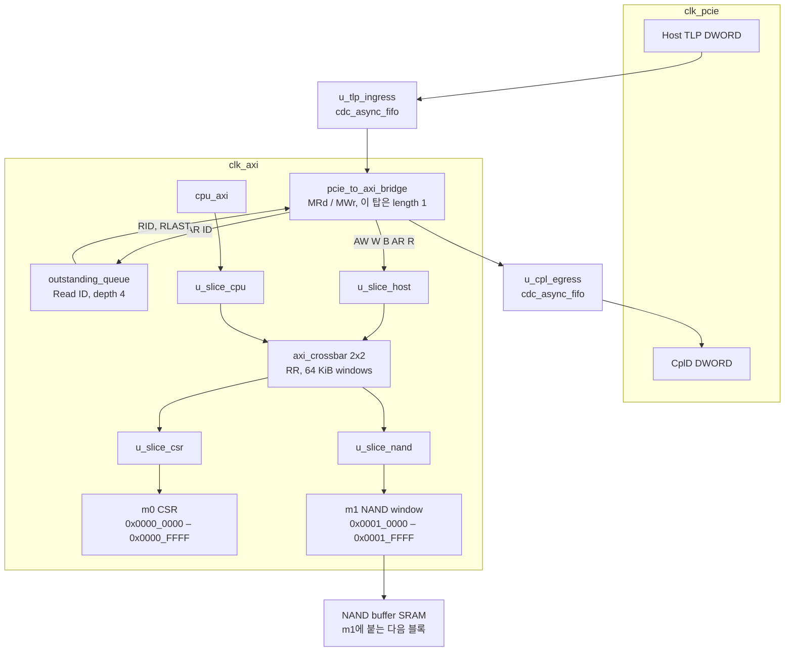

# AXI Multi-Layer Interconnect & PCIe Protocol Bridge

낸드 컨트롤러 안에서 호스트, 펌웨어 CPU, 낸드 채널이 한 칩 위에서 어떻게 붙는지 공부하면서 정리한 서브시스템이다. PCIe 트랜잭션을 AXI로 넘기고, 멀티레이어 인터커넥트가 제어 평면과 데이터 평면을 목적지 포트로 나눈다.

현재 저장소의 제어 평면은 `nand_sol_subsystem_top`으로 묶여 있다. `clk_pcie`의 TLP는 **cdc_async_fifo**를 지나 `clk_axi`의 **pcie_to_axi_bridge**로 들어가고, 길이 1인 트랜잭션이 **AXI4-Lite register slice**와 **2x2 crossbar**를 지난다. **outstanding_queue**가 호스트 Read ID를 추적한다. PCIe PHY와 컨트롤러 본체, 데이터 평면의 긴 버스트 규칙은 이후 자리다.

## 디렉터리

```text
.
├── rtl/     합성 가능한 SystemVerilog
├── verif/   Cocotb 테스트, BFM, 시뮬레이터 러너
├── asic/    Sky130 합성 스크립트, SDC, OpenSTA
├── docs/    아키텍처 노트, 어드레스 맵, 인터페이스 사양
└── sim/     시뮬레이터 빌드, 로그, 웨이브, results.xml
```

| 경로 | 역할 |
| --- | --- |
| `rtl/axi_register_slice.sv` | AXI4-Lite 5채널 레지스터 슬라이스와 채널 리프 `axi_channel_reg_slice` |
| `rtl/axi_crossbar.sv` | 2x2 AXI4-Lite 크로스바. 주소 디코드, 슬레이브별 라운드로빈 |
| `rtl/cdc_async_fifo.sv` | 듀얼 클록 FIFO. 그레이 포인터, 2단 동기화기 `cdc_sync_2ff` |
| `rtl/pcie_to_axi_bridge.sv` | Memory TLP를 AXI4 INCR 버스트로 변환. 요청/완료가 각각 FIFO를 통과 |
| `rtl/outstanding_queue.sv` | AXI Read ID 추적. AR에서 슬롯을 잡고 R에서 돌려놓음 |
| `rtl/nand_sol_subsystem_top.sv` | 브리지, CDC FIFO, 슬라이스, 크로스바, Read ID 큐를 묶는 탑 |
| `verif/Makefile` | `sim` / `clean`. DUT는 slice, crossbar, fifo, bridge, top |
| `verif/run_sim.py` | Cocotb 1.8 / 2.x 러너 |
| `verif/axi_lite_bfm.py` | 채널 드라이버와 메모리 슬레이브 |
| `verif/test_axi_register_slice.py` | 슬라이스: 리셋, read/write, 백프레셔, 연속 처리량 |
| `verif/test_axi_crossbar.py` | 크로스바: 병렬 전달, 라운드로빈, DECERR, AW/W 분리 |
| `verif/test_cdc_async_fifo.py` | FIFO: full/empty, 포인터 동기화 지연, 랩어라운드 |
| `verif/test_pcie_to_axi_bridge.py` | 2DW Memory Write 후 Memory Read의 CplD |
| `verif/scoreboard.py` | 예측한 write/read와 슬레이브 바이트, CplD, 큐 occupancy 비교 |
| `verif/test_subsystem_top.py` | 탑: 1DW가 MI0/MI1로 갈라지고 Read ID가 추적됨 |
| `docs/architecture.md` | 클록 도메인과 데이터 흐름 |
| `docs/cdc_design_note.md` | CDC 원칙, Sky130 합성, 레이아웃 전 STA |
| `asic/run_sky130.sh` | sv2v 후 Yosys로 Sky130 HD에 매핑 |
| `asic/constraints.sdc` | `clk_pcie` 8 ns, `clk_axi` 10 ns, 비동기 클럭 그룹 |
| `asic/run_sta.sh` | 같은 리버티로 OpenSTA 레이아웃 전 타이밍 |

## 블록 다이어그램

탑 `nand_sol_subsystem_top`이 제어 평면을 한 모듈로 묶는다. `clk_pcie`는 호스트 TLP와 완료 DWORD만 보고, `clk_axi`는 브리지부터 목적지 포트까지를 본다. 두 클록이 함께 들어가는 인스턴스는 `u_tlp_ingress`와 `u_cpl_egress`다. 긴 설명은 `docs/architecture.md`, CDC와 타이밍 메모는 `docs/cdc_design_note.md`에 있다.

```text
 clk_pcie                         clk_axi
 ────────                         ───────

 Host TLP DWORD
      │
      ▼
 ┌────────────────┐
 │ u_tlp_ingress  │  cdc_async_fifo
 │ Gray + 2FF     │
 └───────┬────────┘
        │
        ▼
 ┌──────────────────┐     outstanding_queue
 │ pcie_to_axi_bridge├──── AR에서 ID 할당
 │ MRd / MWr → AXI4 │◄─── R에서 ID 해제, RID/RLAST
 └────────┬─────────┘
          │ AW W B AR R, length 1
          ▼
 ┌────────────────┐     cpu_axi ──► u_slice_cpu ──┐
 │  u_slice_host  │                               │
 └────────┬───────┘                               ▼
          │                              ┌─────────────────┐
          └─────────────────────────────►│  axi_crossbar   │
                                         │  SI0 host       │
                                         │  SI1 CPU        │
                                         │  RR, 64 KiB     │
                                         └───┬─────────┬───┘
                                             │         │
                                             ▼         ▼
                                      u_slice_csr  u_slice_nand
                                             │         │
                                             ▼         ▼
                                      m0 CSR window   m1 NAND window
                                      0x0000_0000     0x0001_0000
                                      –0x0000_FFFF    –0x0001_FFFF
                                             │         │
                                             ▼         ▼
                                      CSR slave    NAND buffer SRAM
                                                   (이 포트에 붙는 다음 블록)

 완료 CplD
      ▲
 ┌────┴───────────┐
 │ u_cpl_egress   │  cdc_async_fifo
 └────▲───────────┘
      └── bridge completion, clk_axi → clk_pcie
```



데이터 평면(버스트 AXI4)과 제어 평면(AXI4-Lite)은 브리지 출구에서 갈라진다. 슬라이스와 크로스바는 제어 평면이다. 브리지는 AXI4 INCR로 나가며, `length==1`인 TLP는 비트 하나의 트랜잭션이다. 탑은 그 한 비트를 슬라이스와 크로스바로 넘긴다. 채널 리프는 페이로드 폭만 바꾸면 데이터 평면 슬라이스가 같은 스키드 구조를 쓴다.

## Subsystem top

모듈 `nand_sol_subsystem_top`. `clk_pcie`와 `rst_pcie_n`은 호스트 TLP와 완료에 연결된다. `clk_axi`와 `rst_axi_n`은 브리지, 레지스터 슬라이스 네 개, 크로스바, outstanding 큐, CPU 포트, MI0, MI1에 연결된다.

요청 DWORD는 `u_tlp_ingress`에서 `clk_axi`로 넘어간다. 완료 DWORD는 `u_cpl_egress`에서 `clk_pcie`로 돌아온다. 브리지의 `pclk`와 `aclk`는 둘 다 `clk_axi`에 묶인다. 브리지 안의 FIFO는 그 클록 안에서 헤더 다음에 페이로드가 오도록 순서를 유지한다.

호스트 AXI는 슬라이스 `u_slice_host`를 거쳐 크로스바 SI0에 붙는다. 펌웨어 CPU는 `cpu_axi_*`에서 슬라이스 `u_slice_cpu`를 거쳐 SI1에 붙는다. MI0(`0x0000_0000`–`0x0000_FFFF`)는 `u_slice_csr` 뒤로, MI1(`0x0001_0000`–`0x0001_FFFF`)는 `u_slice_nand` 뒤로 나간다. 이 탑의 TLP 길이는 1이고, 그때 `AWLEN`과 `ARLEN`은 0이다.

## Outstanding queue

모듈 `outstanding_queue`. `clk_axi`에서 호스트 AR 핸드셰이크마다 ID와 주소를 슬롯에 넣는다. 슬롯이 가득 차 있거나 같은 ID가 이미 나가 있으면 `alloc_ready`가 0이고, 탑은 그 AR을 넘기지 않는다. R 핸드셰이크에서 일치하는 ID 슬롯을 비운다. 라이트 슬레이브에는 RID가 없으므로 큐가 가장 오래된 ID를 브리지의 `RID`로 돌려주고 `RLAST`를 1로 둔다. 깊이 기본값은 4다. `oq_count`는 호스트 리드가 하나 나가 있는 동안 1이고, 끝나면 0이다. CPU 포트의 리드는 이 큐 밖이다.

## AXI4-Lite register slice

모듈 `axi_register_slice`. 슬레이브 포트(`s_axi_*`)가 업스트림 마스터, 마스터 포트(`m_axi_*`)가 다운스트림 슬레이브다.

```text
 s_valid ──►┌──────────┐   ┌──────────┐──► m_valid
 s_data  ──►│ skid reg │──►│ out reg  │──► m_data
            └──────────┘   └──────────┘
 s_ready ◄── ~skid_full         ▲
                                └── m_ready
```

| 항목 | 값 |
| --- | --- |
| 채널 | AW, W, B, AR, R 각각 독립 |
| 지연 | 입력 핸드셰이크 다음 클록에 출력 VALID |
| 처리량 | 양쪽 READY가 유지되면 클록당 1 beat |
| 타이밍 | VALID/페이로드와 READY가 서로 조합 경로로 연결되지 않음 |
| 페이로드 | ADDR+PROT, DATA+STRB, RESP를 그대로 전달 |
| 파라미터 | `ADDR_WIDTH` 1..64 (기본 32), `DATA_WIDTH` 32 또는 64 (기본 32) |
| 리셋 | `aresetn` 비동기 어서트, 동기 디어서트. 제어 플립플롭만 리셋 |

다운스트림이 멈추면 스키드 슬롯이 비트 하나를 받고, 업스트림 READY는 그다음 클록부터 내려간다. 멈춘 사이클 수와 업스트림이 막히는 사이클 수가 같다. 주소 디코드, outstanding 추적, 응답 수정은 하지 않는다.

## AXI4-Lite crossbar

모듈 `axi_crossbar`. 슬레이브 포트 `s0_axi_*`, `s1_axi_*`가 업스트림 마스터 두 개이고, 마스터 포트 `m0_axi_*`, `m1_axi_*`가 다운스트림 슬레이브 두 개다.

기본 주소 맵은 64 KiB 윈도우다. `(addr & mask) == (base & mask)` 이면 히트다.

| 포트 | 기본 범위 |
| --- | --- |
| MI0 | `0x0000_0000` – `0x0000_FFFF` |
| MI1 | `0x0001_0000` – `0x0001_FFFF` |

어느 쪽에도 안 맞거나 양쪽 윈도우에 동시에 맞으면 그 마스터에 `DECERR`을 돌려주고, 다운스트림으로는 나가지 않는다. `M0_BASE`, `M0_MASK`, `M1_BASE`, `M1_MASK`로 맵을 바꿀 수 있다.

마스터 하나에는 write 하나, read 하나가 동시에 나갈 수 있다. AXI4-Lite에는 ID가 없어서 응답 순서를 바꾸지 않는다. AW와 W는 따로 받아서 둘 다 모인 뒤에 같은 슬레이브로만 보낸다. 중재는 다운스트림 슬레이브마다, write와 read를 따로 돌린다. 서로 다른 슬레이브를 향한 마스터 두 개는 같이 진행하고, 같은 슬레이브를 향한 요청만 라운드로빈으로 직렬화한다. 이긴 마스터는 큐의 맨 뒤로 가고, B 또는 R을 그 마스터가 받을 때까지 그 슬레이브의 해당 방향은 잠긴다.

## CDC async FIFO

모듈 `cdc_async_fifo`. 쓰기 클록과 읽기 클록이 다르다. 포인터는 자기 클록 안에서는 바이너리고, 반대편으로 넘길 때만 그레이 코드다. 각 방향은 `cdc_sync_2ff` 두 단을 지난다. `wr_full`은 쓰기 클록에서, `rd_empty`는 읽기 클록에서 만든다. `rd_data`는 `rd_empty`가 0인 동안 현재 머리의 값이고, `rd_en`이 그 워드를 꺼낸다.

`DEPTH`는 4 이상의 2의 거듭제곱이다. `wr_rst_n`과 `rd_rst_n`은 같이 잡고, 각 클록에 맞춰 풀어야 한다. 쓰기 포인터가 읽기 쪽에 보이려면 `rd_clk` 상승 에지가 적어도 두 번 지나야 하므로, 그 전에 `rd_empty`가 내려가면 동기화기를 건너뛴 것이다.

## PCIe-AXI bridge

모듈 `pcie_to_axi_bridge`. PCIe MAC은 포함하지 않는다. 이웃 블록이 `pclk`에서 TLP DWORD를 한 박자씩 준다. `tlp_sop`는 첫 DWORD, `tlp_eop`는 마지막 DWORD다.

받는 요청은 Memory Write와 Memory Read다. 3DW 헤더와, 상위 주소가 0인 4DW 헤더를 받는다. 상위 주소가 0이 아니거나 Memory가 아니면 그 TLP는 버리고 `tlp_error`를 한 클록 올린다. 길이는 `MAX_DW`(기본 16)까지다.

요청은 헤더 비트 다음에 페이로드 순서로 요청 FIFO를 지난다. AXI 클록에서는 AXI4 INCR, 비트 폭 4바이트로 나간다. 한 트랜잭션만 outstanding이다. Memory Write는 posted라 완료 TLP가 없다. Memory Read의 R 데이터는 AXI 클록에서 모은 뒤 3DW CplD로 만들고, 완료 FIFO를 통해 `pclk`로 내보낸다. 첫 DWORD의 `cpl_sop`, 마지막 DWORD의 `cpl_eop`가 1이다.

## 시뮬레이션

Python 3.9 이상, GNU Make, Cocotb 1.8 또는 2.x, Icarus Verilog 12 이상 또는 Verilator 5 이상이 필요하다.

```bash
cd verif
pip install -r requirements.txt
make sim
make sim SIM=verilator WAVES=1
make sim DUT=crossbar SIM=verilator
make sim DUT=fifo SIM=verilator
make sim DUT=bridge SIM=verilator
make sim DUT=top SIM=verilator
make sim TESTCASE=test_reset_outputs_idle
make clean
```

`DUT` 기본값은 `slice`다. `make`가 없으면 `python run_sim.py --sim icarus --dut fifo`로 같은 경로를 탄다. 웨이브와 `results.xml`은 `sim/` 아래에 생성된다. `slice` 이외의 빌드는 `sim/build/<dut>/`에 따로 둔다.

| 테스트 | 확인하는 것 |
| --- | --- |
| `test_reset_outputs_idle` | 리셋 후 VALID=0, 빈 슬라이스의 READY=1 |
| `test_write_read_and_strobe` | 5채널을 지나는 write, byte strobe, read-back. 채널마다 2클록 백프레셔 |
| `test_aw_backpressure_preserves_beats` | AW 8 beat를 다운스트림이 beat마다 4클록 멈춰도 순서와 개수가 유지됨 |
| `test_aw_back_to_back_throughput` | READY가 계속 1이면 지연 1클록, 이후 클록마다 1 beat |
| `test_parallel_masters_different_slaves` | 슬레이브 0이 멈춰 있는 동안 슬레이브 1 트랜잭션이 먼저 끝남 |
| `test_round_robin_on_shared_slave` | 같은 슬레이브에서 다음 경합의 승자는 직전 승자가 아님 |
| `test_decode_error_does_not_stall_the_other_master` | 미매핑 주소는 DECERR, 다른 마스터는 통과 |
| `test_wdata_may_follow_awaddr` | W가 AW보다 늦거나 빨라도 스트로브가 유지됨 |
| `test_fill_sets_full_and_extra_write_is_dropped` | 슬롯이 차면 full, 그 뒤의 wr_en은 버려짐 |
| `test_empty_waits_for_write_pointer_sync` | empty는 rd_clk 2에지 뒤에야 내려감 |
| `test_full_waits_for_read_pointer_sync` | full은 읽기 포인터가 wr_clk에 보이기 전에 안 풀림 |
| `test_wrap_under_both_clocks` | 포인터가 한 바퀴 이상 돌아도 순서가 유지됨 |
| `test_memory_write_and_read_cross_clocks` | 2DW MWr이 AXI에 쌓이고, MRd의 CplD가 같은 데이터를 돌려줌 |
| `test_single_beat_windows_track_read_id` | 1DW MWr/MRd가 MI0와 MI1로 갈라지고, CplD와 `oq_count`가 맞음 |

## 다음으로 채울 자리

- 인터커넥트 포트 수를 2x2보다 키우고, 레이어와 QoS를 더하는 일
- 데이터 평면 AXI4의 긴 버스트. 탑의 큐는 제어 평면 Read ID를 깊이 4까지 추적한다
- PCIe PHY, DLL, 다중 outstanding completion
- 낸드 채널을 MI1의 NAND buffer 뒤에서 여러 포트로 나누는 일
- 인터페이스 사양의 레지스터 맵

## 커밋과 브랜치

`main`은 시뮬레이터가 통과하는 탑을 둔다. 기능은 `feat/<block>` 브랜치에서 끝내고 `main`으로 합친다. 메시지는 한 줄이고, 종류는 이렇게 나눈다.

| 접두어 | 쓸 때 | 이 저장소의 예 |
| --- | --- | --- |
| `feat:` | 새 RTL 또는 새 테스트 경로 | `feat: add gray-code async fifo` |
| `fix:` | 시뮬레이션에서 틀린 동작 | `fix: index completion buffer with beat width` |
| `test:` | 체크만 더할 때 | `test: scoreboard checks subsystem completions` |
| `docs:` | README와 `docs/` | `docs: describe cdc and the control-plane path` |
