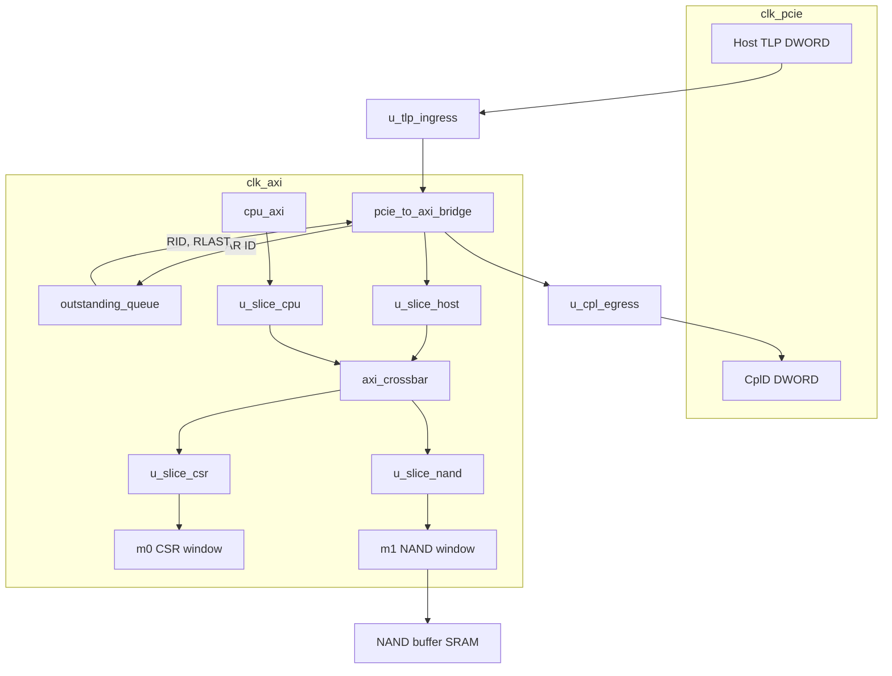

# 제어 평면 아키텍처

`nand_sol_subsystem_top` 안에 실제로 연결된 경로다. PCIe PHY, DLL, 낸드 버퍼 SRAM 본체는 이 저장소 밖이고, SRAM이 붙는 자리는 크로스바 MI1이다.

## 클록

| 클록 | 리셋 | 보는 것 |
| --- | --- | --- |
| `clk_pcie` | `rst_pcie_n` | 호스트 TLP DWORD, 완료 DWORD, `u_tlp_ingress` 쓰기, `u_cpl_egress` 읽기 |
| `clk_axi` | `rst_axi_n` | 브리지, 슬라이스 네 개, 크로스바, outstanding 큐, CPU 포트, MI0, MI1 |

두 클록이 한 인스턴스에 같이 들어가는 곳은 `u_tlp_ingress`와 `u_cpl_egress`뿐이다. 브리지의 `pclk`와 `aclk`는 둘 다 `clk_axi`다. 브리지 안의 FIFO는 그 클록에서 헤더 다음에 페이로드가 나가도록 순서를 유지한다.

## 데이터 흐름

호스트에서 낸드 윈도우로 가는 쓰기는 아래 순서다. 길이가 1인 Memory Write만 이 탑을 지난다. 그때 AXI의 `AWLEN`과 `ARLEN`은 0이다.

```text
Host TLP (clk_pcie)
  → u_tlp_ingress          cdc_async_fifo, Gray pointer, 2-stage sync
  → pcie_to_axi_bridge     Memory TLP를 AXI4 INCR 한 비트로
  → u_slice_host           AXI4-Lite, 지연 1클록
  → axi_crossbar SI0       주소 디코드, 슬레이브별 라운드로빈
  → u_slice_nand           MI1 쪽 타이밍 컷
  → m1                     0x0001_0000 – 0x0001_FFFF
  → NAND buffer SRAM       이 포트에 붙는 다음 블록
```

읽기는 같은 길을 거꾸로 돌아온다. R 데이터는 브리지가 `clk_axi`에서 CplD로 만든 뒤 `u_cpl_egress`를 지나 `clk_pcie`의 완료 DWORD가 된다. Write는 posted라 완료 TLP가 없다.

Outstanding queue는 이 데이터 통로 한가운데에 있지 않다. 브리지가 내는 AR의 ID를 `clk_axi`에서 기억하고, 라이트 패브릭이 R을 돌려주면 그 ID를 `RID`로 다시 실어 `RLAST`를 1로 둔다. 낸드 리드가 늦게 돌아와도 호스트 태그와 응답이 짝을 잃지 않게 하는 자리다. 깊이 기본값은 4다. CPU 포트의 리드는 이 큐를 지나지 않는다.

```text
 clk_pcie                         clk_axi
 ────────                         ───────

 Host TLP DWORD
      │
      ▼
 ┌──────────────┐
 │ u_tlp_ingress │
 └──────┬───────┘
        ▼
 ┌────────────────────┐      outstanding_queue
 │ pcie_to_axi_bridge ├───── AR ID in
 └─────────┬──────────┤◄──── RID, RLAST out
           │
           ▼
    u_slice_host          cpu_axi → u_slice_cpu
           │                      │
           └──────────► axi_crossbar ◄┘
                        SI0 host, SI1 CPU
                          │           │
                    u_slice_csr   u_slice_nand
                          │           │
                     m0 CSR        m1 NAND window
                     0x0000_0000   0x0001_0000
                          │           │
                     CSR slave    NAND buffer SRAM

 CplD DWORD
      ▲
 ┌────┴─────────┐
 │ u_cpl_egress │
 └────▲─────────┘
      └── bridge, clk_axi
```



## 포트

| 포트 | 누구 | 윈도우 |
| --- | --- | --- |
| 브리지 AXI, 크로스바 SI0 | 호스트 | 디코드 결과대로 MI0 또는 MI1 |
| `cpu_axi_*`, 크로스바 SI1 | 펌웨어 | 같은 맵 |
| `m0_axi_*` | CSR 슬레이브 | `0x0000_0000` – `0x0000_FFFF` |
| `m1_axi_*` | 낸드 버퍼가 붙는 슬레이브 | `0x0001_0000` – `0x0001_FFFF` |

히트는 `(addr & mask) == (base & mask)` 이다. 어느 쪽에도 안 맞거나 양쪽 윈도우에 동시에 맞으면 그 마스터에 `DECERR`이 돌아가고, 다운스트림 포트는 건드리지 않는다.

## 슬라이스가 자르는 곳

레지스터 슬라이스는 네 군데다.

| 인스턴스 | 업스트림 | 다운스트림 |
| --- | --- | --- |
| `u_slice_host` | 브리지 | 크로스바 SI0 |
| `u_slice_cpu` | `cpu_axi` | 크로스바 SI1 |
| `u_slice_csr` | 크로스바 MI0 | `m0` |
| `u_slice_nand` | 크로스바 MI1 | `m1` |

각 슬라이스는 AW, W, B, AR, R을 따로 끊는다. 다운스트림이 준비돼 있으면 지연은 1클록이고, 멈추면 스키드 한 칸이 비트를 받아 둔다. 크로스바 출력 먹스가 이웃 블록의 조합 논리와 한 클록에 붙지 않게 하는 배치다. 타이밍과 면적 이야기는 `cdc_design_note.md`에 있다.
